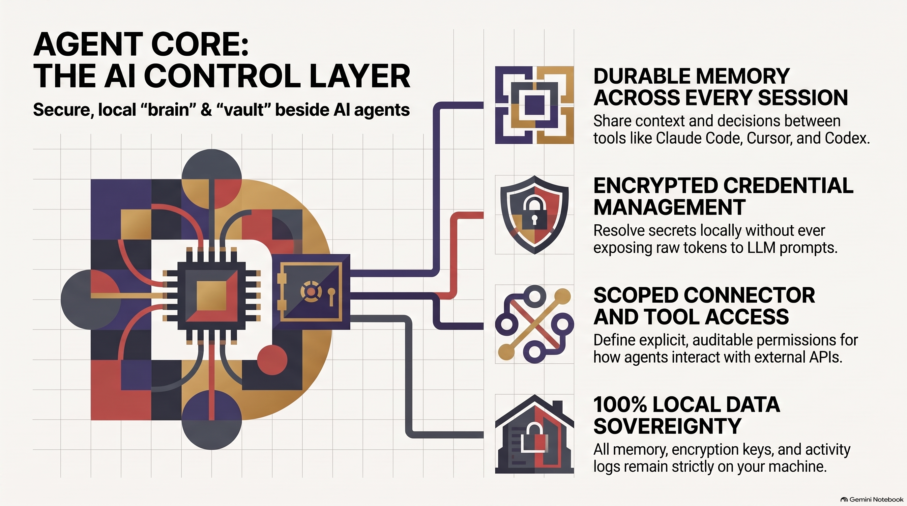
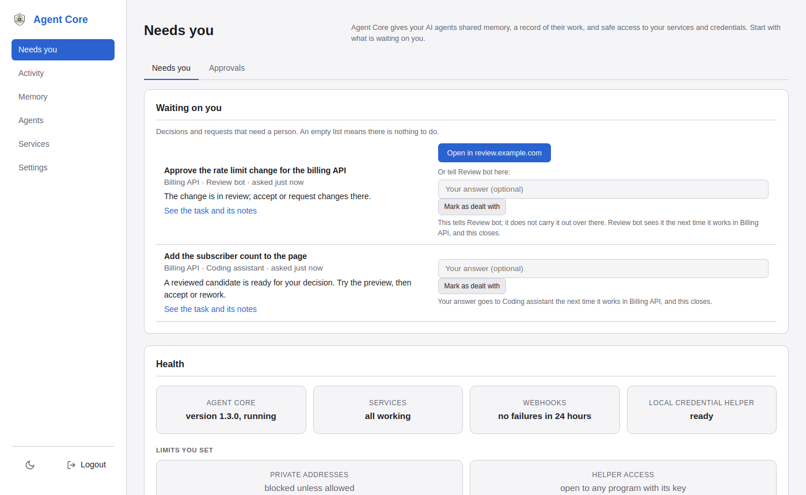
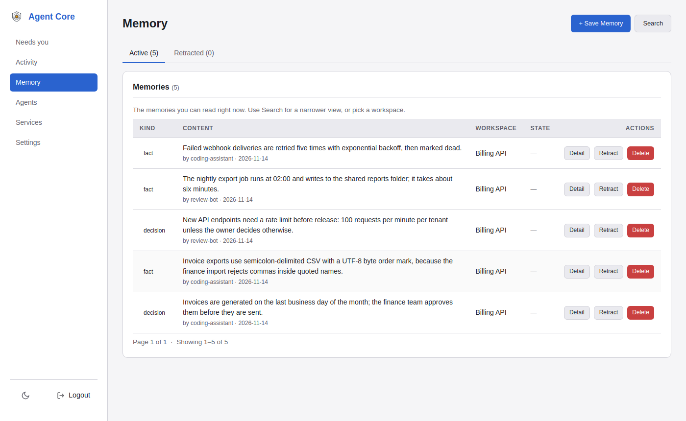
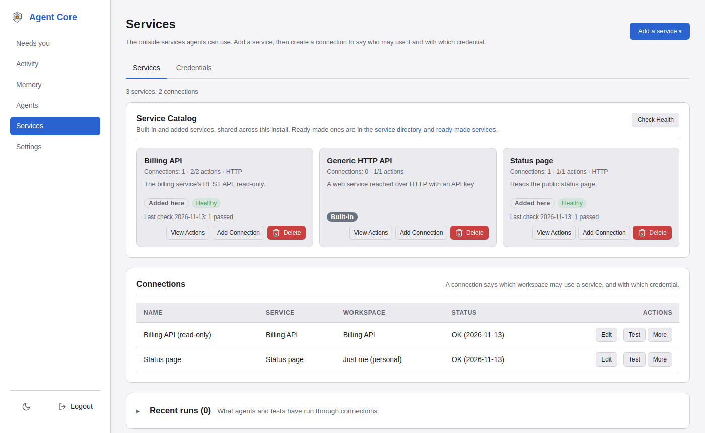
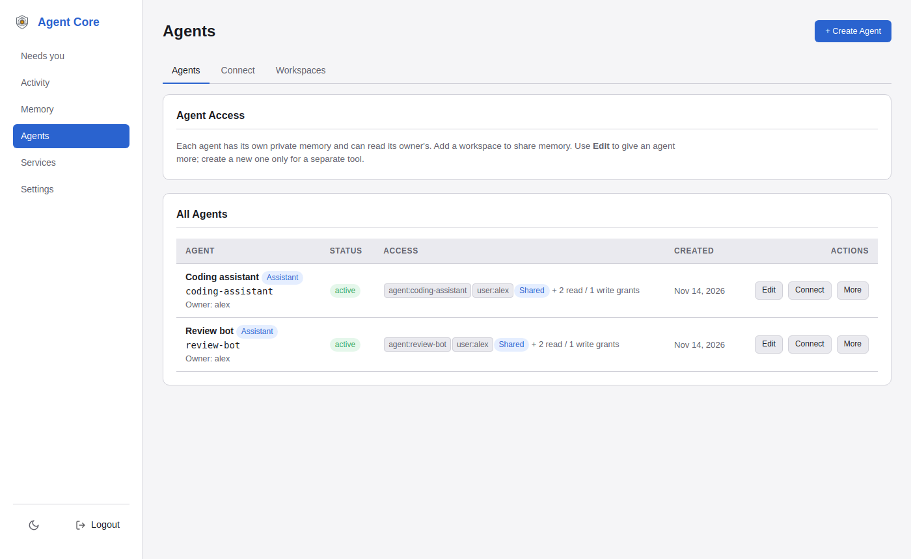
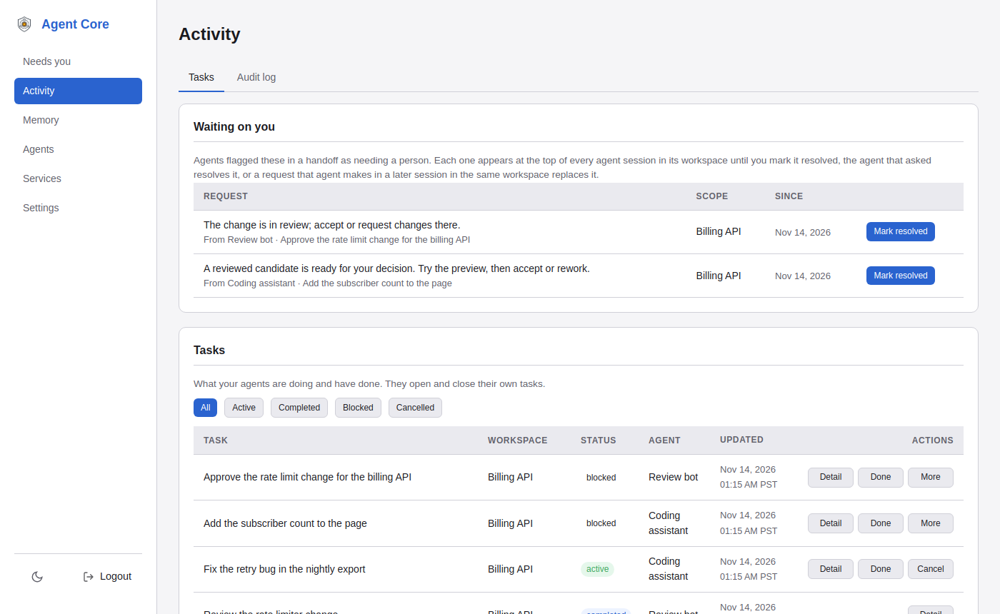

# Agent Core

**Shared memory and controlled capabilities for the agents you already use.**

Agent Core is a self-hosted MCP and HTTP service. It gives Claude Code, Codex, Cursor, and custom agents durable context, encrypted credentials, scoped service access, and an auditable activity trail.

**Agent Core sits beside agents, not above them.**

## Start with memory, then add capabilities

Most installations need only shared memory at first. Add the next layer when a real task needs it.

1. [Install Agent Core](#get-running-in-minutes), create an agent, and connect it with MCP.
2. [Write and recall shared memory](#memory-that-persists-across-sessions). This is the default reason to use Agent Core.
3. Add encrypted credentials, used through service connections, [credential consumers](docs/credential-consumers.md) or, for a local tool, the [local credential helper](docs/credential-broker.md).
4. Add [service connections](docs/integrations.md#services-agent-core-runs-actions-directly) when Agent Core should call an external service itself.
5. Use activities, workspaces, webhooks, backups, and administration when your work needs them.

You do not need to configure every capability before your first agent can use memory.

---

If you use AI coding agents like Claude Code, Cursor, or Codex, you've probably run into this:

- You start a new session and have to re-explain the same decisions all over again
- You juggle API keys and tokens across tools, pasting them into configs and hoping nothing leaks
- Two agents working on the same project have no idea what the other one has done

Agent Core fixes that. It is a small service that you run on your own machine. Your agents connect to it to read and write memory, resolve credentials, and call external services, while the controls stay local and explicit.



---

## What Agent Core does

Agent Core provides:

- durable memory in one place
- access control for credentials and external services
- server-side services for imported OpenAPI specs, native MCP servers, and **adapters**, which are shareable data-manifest integrations for OAuth, session handshakes, and CLI wrappers (see [docs/adapters.md](docs/adapters.md))
- activity visibility and on-demand handoffs

Agent Core is not:

- an agent runtime or agent framework
- a coding assistant or computer-use environment
- a scheduler or orchestration engine
- a sandbox or cloud execution environment
- a replacement for the agent itself

## What you install

A fresh install gives you a local control layer that agents can actually use:

- a shared place to keep durable memory
- a way to manage credentials without exposing raw secrets
- a service and service catalog that agents can call through MCP
- visibility into which agents are active and what they're doing
- a clean dashboard for setup, oversight, and handoffs

---

## How it works

Agent Core is a local HTTP server. It speaks REST and MCP (Model Context Protocol), so anything that can make an HTTP request can talk to it. Agents authenticate with an API key and use tools like `memory_search`, `memory_write`, `credential_get`, and the service discovery/execution tools.

Memory, credentials, and configuration all live on your disk. Outbound traffic happens when an agent runs a service action, when scheduled maintenance tests a service connection to verify a memory anchored to it, when you browse the public service directory for service imports, and when you register outbound webhooks. Nothing else leaves the host.

For the full picture, read **[How it works](docs/how-it-works.md)**: how memory is modelled, what keeps the corpus honest, how services and credentials fit together, and the reasoning behind each.

```
┌──────────────┐     MCP or HTTP     ┌────────────────────────────┐
│  Claude Code │ ──────────────────► │         Agent Core         │
│  Cursor      │ ──────────────────► │ shared memory              │
│  Codex       │ ──────────────────► │ encrypted credentials      │
│  any agent   │ ──────────────────► │ scoped connector access    │
└──────────────┘                     │ activity and handoffs      │
                                     └────────────┬───────────────┘
                                                  │
                       ┌──────────────────────────┴──────────────────────────┐
                       ▼                                                     ▼
          ┌─────────────────────────┐                         ┌─────────────────────────┐
          │ SQLite and encrypted    │                         │ External services       │
          │ credentials on your disk│                         │ via connector bindings  │
          └─────────────────────────┘                         └─────────────────────────┘
```

---

## What it looks like

The dashboard gives you a central view of your connected agents, active memory, stored credentials, and service connections. After setup, it's the quickest way to confirm the service is running and your agents have what they need.



---

## Capabilities your agents can use

### Memory that persists across sessions

When an agent makes a decision or learns something useful, it writes that to Agent Core. The next time any agent starts, whether it's the same tool, a different one, or a week later, it can search for that context and pick up where things left off.

```
Claude Code writes: "We decided PostgreSQL over SQLite for the prod database."
                          ↓
Codex searches:     memory_search("database decision") → gets that record back
```

Memory is scoped. Agents only see what they're allowed to: their own private agent scope, shared project context, or your personal preferences. Nothing bleeds across unless you want it to.

Memory records are one of two kinds, and the difference decides what the system can do with them. A **fact** is settled by checking: someone could verify it against the code, a host, or a service. A **decision** is settled by someone deciding, and nothing can verify it. That split is what lets Agent Core re-check facts on a schedule while leaving your decisions alone.

Facts can name what would confirm them (`repo:<path>` or `service:<binding>`; a `host:<name>` is a label that only a binding an operator mapped can check), and the maintenance sweep checks the ones it can, recording what it found. Search results say how long it has been since anyone confirmed a record, so an agent can tell a fact verified today from one nobody has checked in months. Unconfirmed, non-human facts receive a small ranking penalty until someone confirms them with evidence. Ranking follows the same principle: observed provenance, recall, and usefulness rather than a score the author gave itself.

Plain noise retracts itself: per-occurrence logs, ticket-closeout narration, duplicates, and facts whose anchor has been gone for two checks an hour apart. A retraction is soft (restorable for the retention period) and audited, and nothing is left for a person to review.

> Without semantic search configured, exact keywords matter more than fuzzy phrasing. `memory_search("authentication")` won't match a record that says "login logic", so use terms that match what was actually written. See [Requirements](#requirements) for how to enable semantic search.

Keyword search ranks matches by text relevance alongside confirmation and usefulness signals. Agents can pass `max_response_chars` to memory search to receive a whole-record response within a chosen character budget. Over MCP the budget defaults to the inline size limit. See the [search API contract](docs/api.md#memory). `scripts/value_report.py` reports whether stored data reaches agents: read-through of offloaded results, empty searches per agent, never-recalled memory per scope, and sync-stream noise.



### Credentials and services

The **Credentials** page holds stored credentials and the **Services** page holds service connections. This is the capability layer: agents do not route through a scheduler or OS. They connect to a service catalog and call the capabilities they need, whether that capability came from an imported OpenAPI spec, a native MCP server, an installed adapter, or the built-in Generic HTTP fallback.

A credential is the encrypted secret itself: a GitHub PAT, API key, URL, password, or other value. A service connection is how Agent Core uses one stored credential with a service such as an imported OpenAPI API, a native MCP server registration, an installed adapter, or the built-in Generic HTTP escape hatch.

Agent Core can also connect to trusted internal services on your own network without weakening global URL checks. See [Configuration](docs/configuration.md) for details on `AGENT_CORE_ALLOWED_INTERNAL_HOSTS` and connection overrides.

You store a credential entry in Agent Core once. You can edit its name, label, and type later. If you leave the replacement secret field blank while editing, Agent Core keeps the existing encrypted value; if you enter a new value, it overwrites the stored secret.

From there, there are three paths, most used first:

- If you run an action through a service connection, Agent Core uses the stored credential server-side to call the external service and returns the result. The agent never sees the secret.
- If a service or container needs its own secrets at startup, give it a [credential consumer](docs/credential-consumers.md): an identity that can fetch only the entries granted to it.
- If a local tool needs a secret in its own config, Agent Core returns a reference like `AC_SECRET_GITHUB_TOKEN_1A2B3C4D`, and the local credential helper resolves it at runtime. It only matters for a tool you run yourself that cannot go through a service connection.

In both cases, the raw secret never appears in prompts, logs, or generated configs.

```
You store:   GitHub PAT → encrypted credential entry
You bind:    imported GitHub connector binding → points at that credential
Agent gets:  AC_SECRET_GITHUB_TOKEN_1A2B3C4D  (just a reference)
At runtime:  The local credential helper injects the token locally, or the connector executor uses it server-side
```



### Shared context across tools and people

Working with a team, or switching between Claude Code and Cursor on the same project? Create a workspace and grant each agent access to it. At session startup, an agent gets its session context (or calls `workspace_sync`) to receive the open work, recent results and workspace changes since that execution's last acknowledged cursor. Targeted `memory_search` calls still fill gaps when the agent needs older context.

Sync is an explicit pull, not a background process. Each session has its own execution ID, even when two sessions use the same agent identity. That lets one Codex session see work recorded by another Codex session without confusing the two sessions. As a fallback, starting a new workspace activity can return a bounded `since_last_active` digest. Agent Core omits that digest when the supplied execution is already caught up through `workspace_sync`.



---

## Activity and handoffs

The activity page lists what your agents are doing and have done, and what is waiting on you. A task nobody has updated for 48 hours closes itself as "ended without report".

Activity tracking is self-reported. There is no automatic detection of agent work: a working agent must call `activity_update` at the start of a task and periodically as a heartbeat. Without that, nothing appears in the dashboard and no handoff is recorded.

The trail is searchable, and it is the right home for "what did we do on X last month". Durable memory is for what stays true; the activity trail is for what happened. Agents that record per-task progress in memory instead get told so on write.

The session-start tools are:

```
session_context   → one session-start block: rules, waiting work, recent results, changes
workspace_sync    → receive new workspace context and changes for this execution
workspace_sync_ack → acknowledge a delivered page after processing it
activity_search  → search what agents have already worked on ("what did we do on X")
activity_list    → find what's stale or pending (for reviews and handoffs)
attention_list   → what is waiting on a person, across the scopes you read (for coordinators)
memory_search    → fill in any gaps with a targeted query
```

`workspace_sync` reports what changed. It is an explicit pull: agents call it at session boundaries and task boundaries, not on a background schedule.



---

## Get running in minutes

### Docker (recommended)

```bash
git clone https://github.com/nikira-studio/agent-core agent-core
cd agent-core
cp .env.example .env
cp docker-compose.example.yml docker-compose.yml
docker compose up -d
```

Open `http://localhost:3500`. The setup screen walks you through creating an admin account. Whoever opens the dashboard first becomes the admin, which is why the example compose file listens on this machine only (`127.0.0.1`).

> `docker-compose.yml` is gitignored so your local settings (data paths, ports, custom networks) stay private. Edit it before starting if you need to change anything.

### Local Python

```bash
git clone https://github.com/nikira-studio/agent-core agent-core
cd agent-core
python3 -m venv .venv      # 3.11 or 3.12
source .venv/bin/activate   # Windows: .venv\Scripts\activate
pip install -r requirements.txt
cp .env.example .env
uvicorn app.main:app --reload --port 3500   # run from the project folder, the one containing app/
```

---

## Connect your first agent

1. **Create a workspace.** Open **Agents → Workspaces** and create one, for example `my-project`. A workspace is the shared place where your agents keep memory and tasks.
2. **Create an agent.** On **Agents**, click **+ Create Agent** and give it a name. Its access to your workspace is ticked for you (read and write); the defaults suit a coding assistant.
3. **Connect it.** The dialog after you save links to the **Connect** page: pick the tool, click **Generate One-Time Key + …**, and copy the key (shown once) and the ready-to-paste config into your tool.

For MCP-compatible clients (Claude Code, Cursor, Claude Desktop):

```json
{
  "mcpServers": {
    "agent-core": {
      "type": "http",
      "url": "http://localhost:3500/mcp",
      "headers": {
        "Authorization": "Bearer YOUR_AGENT_API_KEY"
      }
    }
  }
}
```

For Claude Code specifically, you can also run:

```bash
claude mcp add --transport http --scope user agent-core http://localhost:3500/mcp \
  --header "Authorization: Bearer YOUR_AGENT_API_KEY"
```

For REST-based clients or custom integrations, every feature is also available through the HTTP API.

---

## Documentation

| Doc | What's in it |
| --- | --- |
| [Quickstart](docs/quickstart.md) | Install, connect an agent, write shared memory, then add credentials and services when needed |
| [Integrations](docs/integrations.md) | Set up MCP, credentials, services, activities, collaboration, and webhooks in that order |
| [How it works](docs/how-it-works.md) | The system model and full feature set: memory, activity, credentials, services, and maintenance |
| [Local credential helper](docs/credential-broker.md) | How `AC_SECRET_*` references work and how to resolve them at runtime |
| [Credential consumers](docs/credential-consumers.md) | Give a service or container its own identity that fetches only the secrets granted to it |
| [Configuration](docs/configuration.md) | Environment variables, ports, and data directory layout |
| [Security](docs/security.md) | Scope model, secret handling, and deployment checklist |
| [API reference](docs/api.md) | Full REST and MCP endpoint reference |
| [Backup and restore](docs/backup-restore.md) | Export, restore, and routine maintenance |
| [Troubleshooting](docs/troubleshooting.md) | Common issues and fixes |

---

## Your data stays on your machine

```
data/
  agent-core.db       ← SQLite database (memory, agents, credentials, activity)
  credential.key      ← Encryption key for credentials
  credential.keyring  ← Key history (used for decryption after key rotation)
  broker.credential   ← Key for the local credential helper (auto-generated)
  backups/
```

`data/` is gitignored. The full backup export from the dashboard bundles the database and encryption key material together. You need both to restore.

---

## Requirements

- Docker with Compose, **or** Python 3.11 or 3.12 for local development
- SQLite with FTS5 (standard in the Docker image and most Python 3.11 builds)
- Optional: [Ollama](https://ollama.com) for semantic (AI-powered) memory search. Without it, Agent Core falls back to full-text search. Configure the endpoint and model from **Settings → Memory → Search by meaning** in the dashboard after setup

---

## License

[MIT](LICENSE)
