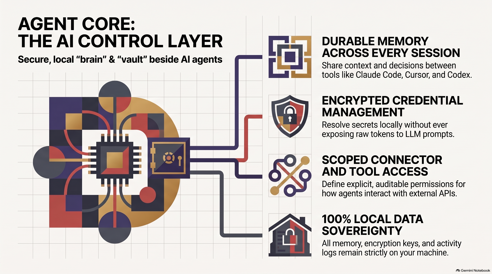
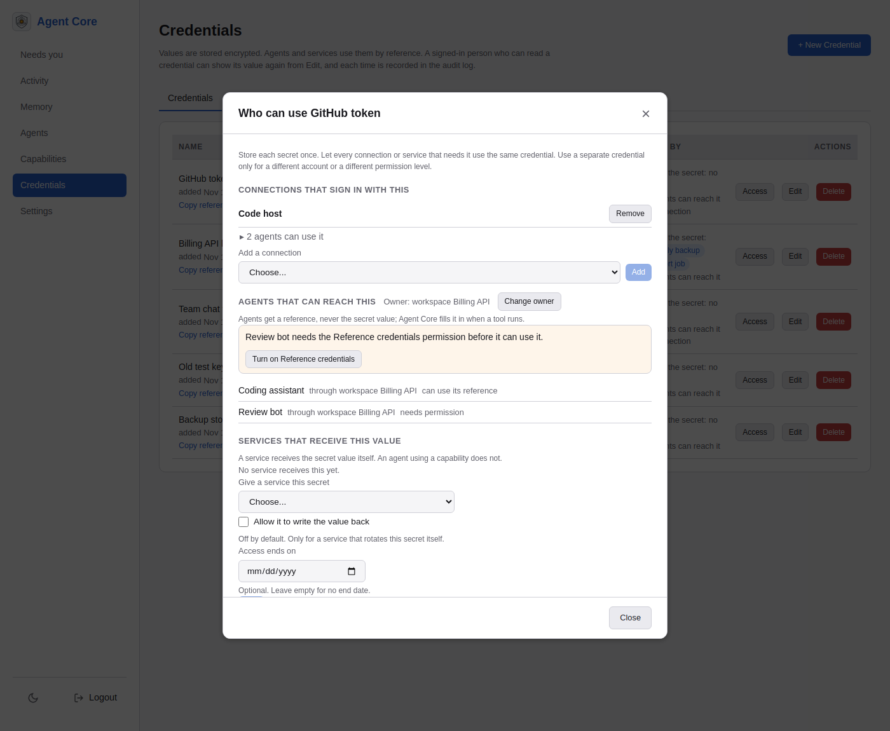

# Agent Core

Agent Core is a program you run on your own computer, with a web page (the dashboard) to manage it. It gives the AI agents you already use (Claude Code, Codex, Cursor and others) a shared memory, an encrypted place for passwords and API keys, and a record of what each agent has done.



## Is it for you?

It is if you use AI coding agents and have run into any of these:

- Every new session starts from zero, and you explain the same decisions again.
- Your API keys are pasted into config files for each tool, and you hope none of them leaks.
- Two agents work on the same project and neither knows what the other did.

Agent Core sits beside your agents. It is not an agent itself, and it does not run or schedule their work.

## What it gives you

- **Memory.** An agent saves short notes about what it decided or learned. The next session, from any tool, can search for them. For example, you settle on a database in Claude Code on Monday, and on Thursday Codex finds that decision. You choose which agents see which memories.
- **Credentials.** You store a password or API key once. It is encrypted on disk with a key kept in your data folder. Agents get a placeholder name for it, never the secret. Agent Core fills in the real value only at the moment a call is made.
- **Capabilities.** Things an agent can do in another service. A GitHub token is a credential. Reading your GitHub issues is a capability that uses it. You set a capability up by adding a connection: the capability plus the credential it uses. Agent Core then makes the call for the agent, so the agent never holds the key.
- **Access control.** You decide which agent may use which capability or credential, and one page shows who can reach what.
- **Activity.** A record of what each agent is working on and has done, and a short list of what is waiting for you.

Everything is stored on your machine. Agent Core contacts other systems only for things you set up or ask for, such as a capability an agent runs or a webhook (a message Agent Core sends to a web address when something happens). [Security](docs/security.md#where-memory-content-can-leave-the-machine) lists every case.

## Install

You need Git and [Docker with Compose](https://docs.docker.com/compose/). To run without Docker, see [Without Docker](#without-docker).

```bash
git clone https://github.com/nikira-studio/agent-core agent-core
cd agent-core
cp docker-compose.example.yml docker-compose.yml
docker compose up -d
```

Docker starts Agent Core in the background on port 3500. Run `docker compose ps` and wait for the status to say healthy. Then open <http://localhost:3500>. The page offers to create your admin account: enter an email, a name and a password of at least 8 characters. Whoever opens the page first becomes the admin, which is why the example setup only listens on your own computer. If the page does not load, see [Troubleshooting](docs/troubleshooting.md).

### Without Docker

You need Git and Python 3.11 or 3.12.

```bash
git clone https://github.com/nikira-studio/agent-core agent-core
cd agent-core
python3 -m venv .venv                # a private Python environment for this project
source .venv/bin/activate        # on Windows: .venv\Scripts\activate
pip install -r requirements.txt
uvicorn app.main:app --port 3500
```

The last command starts the server (uvicorn is the program that runs it). Run it from the folder that contains `app/`, and leave it running in that terminal. Stop it with Ctrl+C. By default it accepts connections from this computer only. Your data goes in a `data` folder in the project. Then open <http://localhost:3500> and create your admin account as above.

## Connect your first agent

In Agent Core, an agent is a name you create for one of your tools, with its own key and its own limits on what it can read and write. The tool uses that agent key to talk to Agent Core.

1. In the left menu, open **Agents**, then the **Workspaces** tab, and create a workspace such as `my-project`. A workspace is a shared place where agents keep their memory and the record of their work for one project. In the same dialog you can link it to your project folder.
2. On the **Agents** tab, choose **+ Create Agent**. Give it an ID (lowercase letters, numbers, hyphens and underscores) such as `coding-agent`, and a name. It gets read and write access to your workspace.
3. Open the **Connect** tab. Choose your agent and workspace, pick your tool, then choose **Generate One-Time Key**. A box asks you to confirm that you want a new key for that agent. Its other keys keep working. The setup then appears with the key filled in. The key is shown only once, so copy it now.

The page says where your tool keeps its settings. Most tools take settings like these, which use MCP (Model Context Protocol), the standard way AI tools call outside programs. Claude Code, Codex and Cursor support it.

```json
{
  "mcpServers": {
    "agent-core": {
      "type": "http",
      "url": "http://localhost:3500/mcp",
      "headers": { "Authorization": "Bearer YOUR_AGENT_KEY" }
    }
  }
}
```

For Claude Code you can run this command instead, or save the JSON above as `.mcp.json` in your project. `--scope user` makes it work in every project:

```bash
claude mcp add --transport http --scope user agent-core http://localhost:3500/mcp \
  --header "Authorization: Bearer YOUR_AGENT_KEY"
```

If your tool runs on another machine or in a container, use an address it can reach instead of `localhost`. The example setup only accepts connections from this computer, so read [Security](docs/security.md) before you change that.

The same page gives you a short instructions file (`CLAUDE.md` or `AGENTS.md`). Save it in your project folder (if you already have one, add the new text to it). It tells the agent when to save and look up memory, so you do not have to remind it.

A tool that does not support MCP can use the [HTTP API](docs/api.md) with the same key.

To check it works, paste the **Verification Prompt** from the bottom of the Connect page into your tool. It asks the agent to write a note, find it again and log the task, then report whether each step worked. The dashboard then shows what the agent did under **Activity**. If a step fails, see [Troubleshooting](docs/troubleshooting.md). Next, the [Quickstart](docs/quickstart.md) shows how to store your first credential and set up a capability.

## What the dashboard looks like

The first page, **Needs you**, lists what is waiting for a person: approvals (changes an agent asks you to allow, such as widening another agent's access), questions an agent left for you, and requests for a credential. Below it, a row of status tiles shows whether your capabilities and webhooks are working.


Every credential has a **Who can use this** list, and every connection (a capability set up with its credential) has a **Who can use it** list. Each change shows who gains and who loses access before you save it.



[The dashboard map](docs/dashboard-map.md) explains every page, with screenshots.

## Learn more

| Read | To learn |
| --- | --- |
| [Quickstart](docs/quickstart.md) | The install and first agent again, in more detail, plus your first credential and capability |
| [How it works](docs/how-it-works.md) | How memory, credentials and capabilities fit together, and why |
| [Dashboard map](docs/dashboard-map.md) | What each page of the dashboard is for |
| [Integrations](docs/integrations.md) | Connecting tools, setting up capabilities, webhooks |
| [Security](docs/security.md) | How secrets and access are protected, and a checklist before you expose Agent Core |
| [Configuration](docs/configuration.md) | Settings, ports and the data folder |
| [Upgrading](docs/upgrading.md) and [Backup and restore](docs/backup-restore.md) | Moving to a new version safely, and keeping your data |
| [Troubleshooting](docs/troubleshooting.md) | Common problems and fixes |
| [API reference](docs/api.md) | Every endpoint and MCP tool |
| [Adapters](docs/adapters.md), [Local credential helper](docs/credential-broker.md), [Credential consumers](docs/credential-consumers.md) | Advanced. Teach Agent Core to talk to a new outside service. Let a program on your machine use a secret without keeping it in a file. Let a program fetch its own secrets when it starts |

## Your data

Agent Core keeps its database and the encryption key for your credentials in one folder: `data/` for a local install, a Docker volume for Docker. Back up both together. A copy of the database without the encryption key cannot decrypt your credentials. See [Backup and restore](docs/backup-restore.md).

## Optional: search by meaning

Memory search matches the words you type. If you also run [Ollama](https://ollama.com) on your machine, search can match meaning as well, so a note about "login logic" turns up when you search for "authentication". Turn it on under **Settings → Memory → Search by meaning**.

## License

[MIT](LICENSE)
