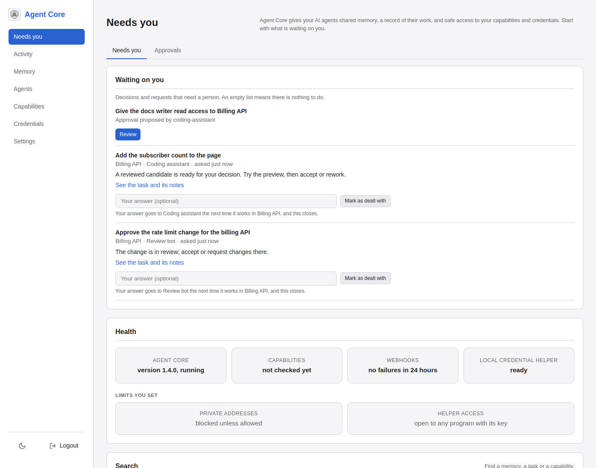

# Agent Core

Agent Core is a program you run on your own computer. It gives the AI agents you already use (Claude Code, Codex, Cursor and others) a shared memory, a safe place for passwords and API keys, and a record of what each agent has done.


## Is it for you?

It is if you use AI coding agents and have run into any of these:

- Every new session starts from zero, and you explain the same decisions again.
- Your API keys are pasted into config files for each tool, and you hope none of them leaks.
- Two agents work on the same project and neither knows what the other did.

Agent Core sits beside your agents. It is not an agent itself, and it does not run or schedule their work.

## What it gives you

- **Memory.** An agent writes down what it decided or learned. The next session, from any tool, can search for it. You choose which agents see which memories.
- **Credentials.** You store a password or API key once, encrypted. Agents get a reference to it, never the secret.
- **Capabilities.** Things an agent can do in another service, such as reading your GitHub issues. You set one up once with a credential. Agent Core makes the call for the agent, so the agent never holds the key.
- **Access control.** You decide which agent may use which capability or credential, and one page shows who can reach what.
- **Activity.** A list of what each agent is working on, and a short list of what is waiting for you.

Everything is stored on your machine. Agent Core contacts other systems only for things you set up or ask for, such as a capability an agent runs or a webhook. [Security](docs/security.md#where-memory-content-can-leave-the-machine) lists every case.

## Install

You need [Docker with Compose](https://docs.docker.com/compose/). To run without Docker, see [Without Docker](#without-docker).

```bash
git clone https://github.com/nikira-studio/agent-core agent-core
cd agent-core
cp docker-compose.example.yml docker-compose.yml
docker compose up -d
```

Open <http://localhost:3500>. The sign-in page offers to create your admin account. Whoever opens the page first becomes the admin, which is why the example setup only listens on your own computer.

### Without Docker

You need Python 3.11 or 3.12.

```bash
git clone https://github.com/nikira-studio/agent-core agent-core
cd agent-core
python3 -m venv .venv
source .venv/bin/activate        # on Windows: .venv\Scripts\activate
pip install -r requirements.txt
uvicorn app.main:app --port 3500
```

Run the last command from the folder that contains `app/`. Then open <http://localhost:3500>.

## Connect your first agent

An agent talks to Agent Core with a key that you create in the dashboard.

1. Open **Agents**, then the **Workspaces** tab, and create a workspace such as `my-project`. A workspace is a shared place where agents keep memory and tasks for one project.
2. On the **Agents** tab, choose **+ Create Agent**. Give it an ID such as `coding-agent` and a name. It gets read and write access to your workspace.
3. Open the **Connect** tab. Choose your agent and workspace, pick your tool, then choose **Generate One-Time Key** and confirm. Agent Core adds a new key to that agent and shows the setup with the key filled in. The key appears once, so copy it now.

The page shows the setup for your tool. Most tools take settings like these, which use MCP (Model Context Protocol), the standard way AI tools call outside programs. Claude Code, Codex and Cursor support it.

```json
{
  "mcpServers": {
    "agent-core": {
      "type": "http",
      "url": "http://localhost:3500/mcp",
      "headers": { "Authorization": "Bearer YOUR_AGENT_KEY" }
    }
  }
}
```

The Claude Code command, if you prefer to type it:

```bash
claude mcp add --transport http --scope user agent-core http://localhost:3500/mcp \
  --header "Authorization: Bearer YOUR_AGENT_KEY"
```

The same page gives you a short instructions file (`CLAUDE.md` or `AGENTS.md`). Save it in your project so the agent knows to use Agent Core.

A tool that does not support MCP can use the [HTTP API](docs/api.md) with the same key.

To check it works, paste the **Verification Prompt** from the bottom of the Connect page into your tool. It asks the agent to write a note, find it again and log the task. The dashboard then shows what the agent did under **Activity**.

## What the dashboard looks like

The first page, **Needs you**, lists what is waiting for a person: approvals, questions an agent left for you, and requests for a credential. Below it, a health strip shows whether your capabilities, webhooks and the local credential helper are working.



Every credential has a **Who can use this** list, and every capability connection has a **Who can use it** list. Each change shows who gains and who loses access before you save it.


[The dashboard map](docs/dashboard-map.md) explains every page, with screenshots.

## Learn more

| Read | To learn |
| --- | --- |
| [Quickstart](docs/quickstart.md) | The install and first agent again, in more detail, plus your first credential and capability |
| [How it works](docs/how-it-works.md) | How memory, credentials and capabilities fit together, and why |
| [Dashboard map](docs/dashboard-map.md) | What each page of the dashboard is for |
| [Integrations](docs/integrations.md) | Connecting tools, setting up capabilities, webhooks |
| [Security](docs/security.md) | How secrets and access are protected, and a checklist before you expose Agent Core |
| [Configuration](docs/configuration.md) | Settings, ports and the data folder |
| [Upgrading](docs/upgrading.md) and [Backup and restore](docs/backup-restore.md) | Moving to a new version safely, and keeping your data |
| [Troubleshooting](docs/troubleshooting.md) | Common problems and fixes |
| [API reference](docs/api.md) | Every endpoint and MCP tool |
| [Adapters](docs/adapters.md), [Local credential helper](docs/credential-broker.md), [Credential consumers](docs/credential-consumers.md) | Advanced: add your own integrations, give a local tool a secret, give a program its own secrets |

## Your data

Agent Core keeps its database and the key that encrypts your credentials in one folder: `data/` for a local install, a Docker volume for Docker. Back up both together. A copy of the database without the key cannot be read. See [Backup and restore](docs/backup-restore.md).

## Requirements

- Docker with Compose, or Python 3.11 or 3.12.
- Optional: [Ollama](https://ollama.com), if you want memory search to match meaning as well as words. Without it, search matches the words you type. Turn it on under **Settings → Memory → Search by meaning**.

## License

[MIT](LICENSE)
