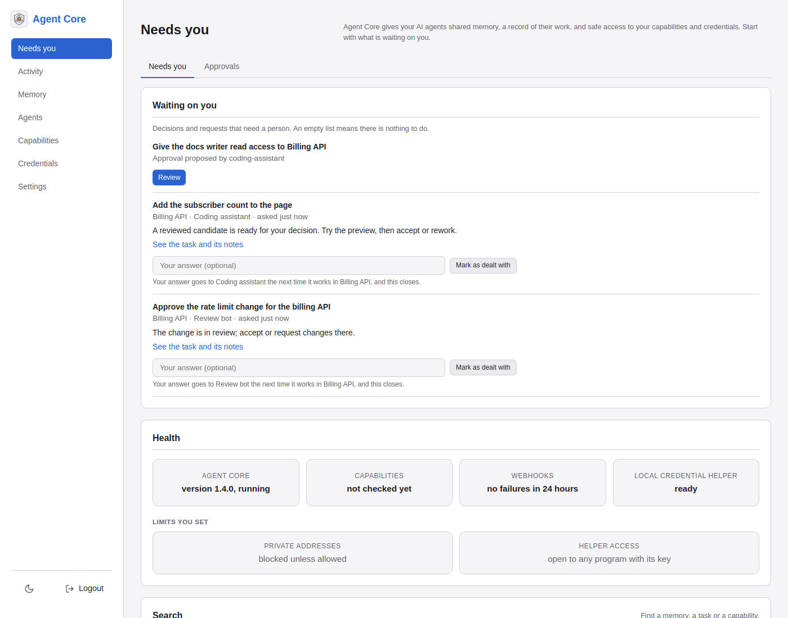
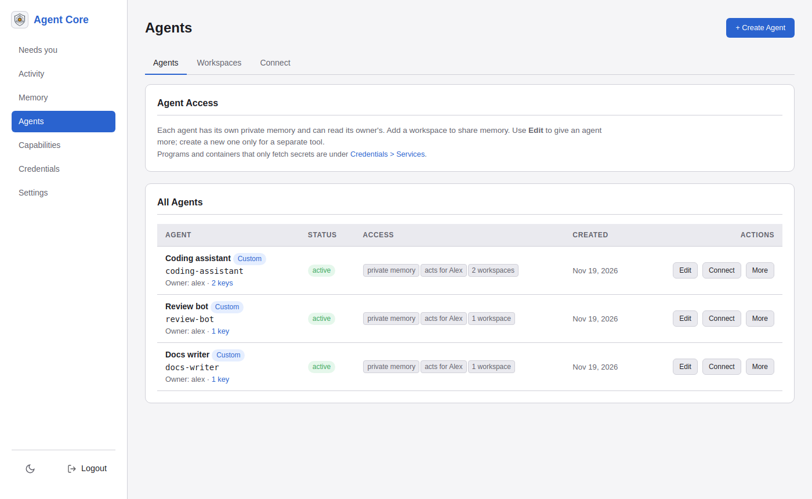
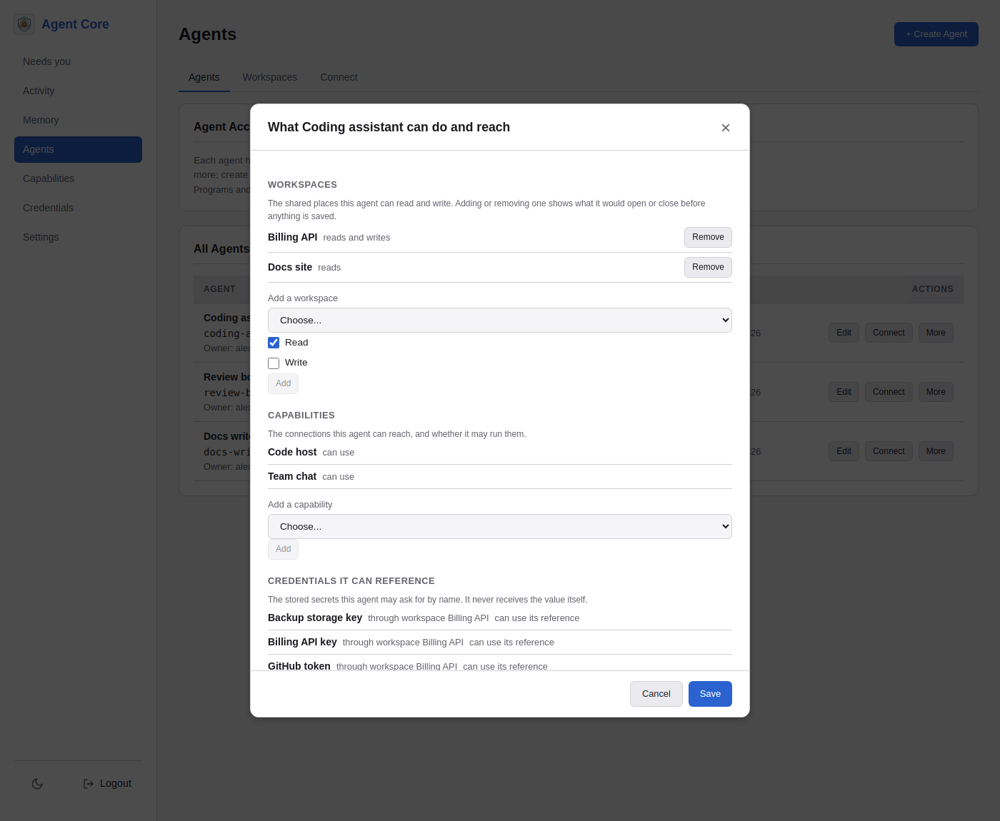
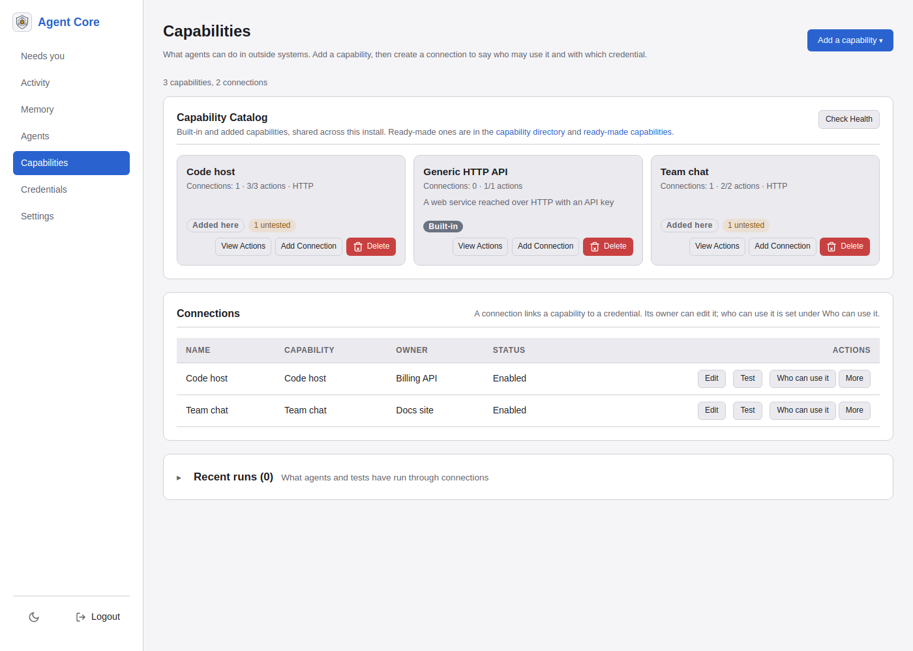
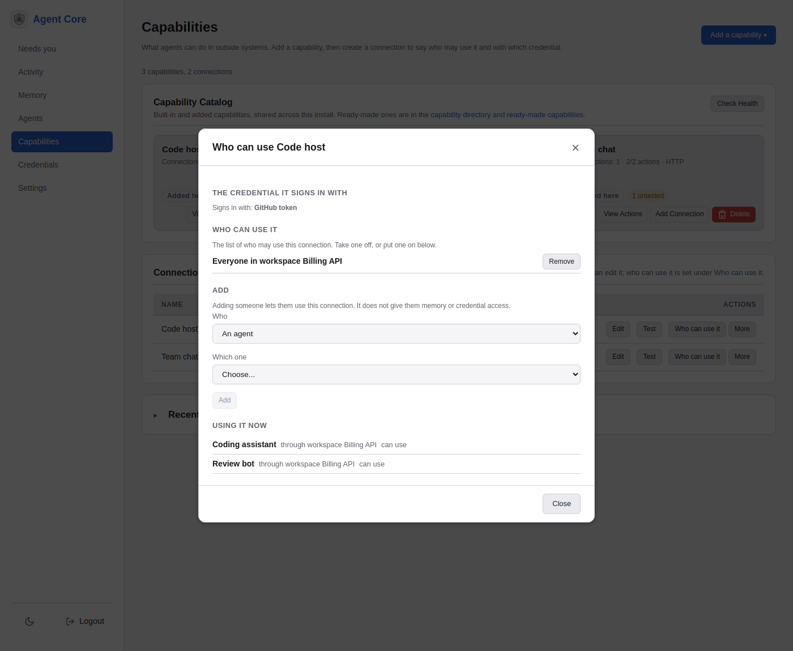
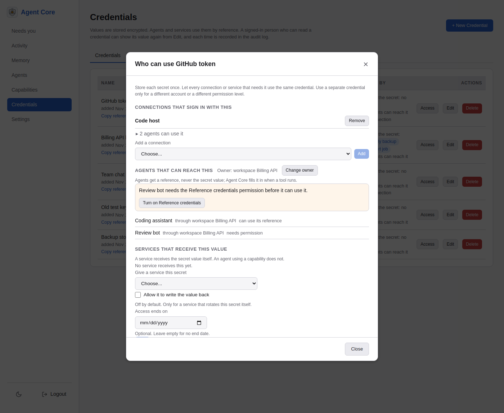
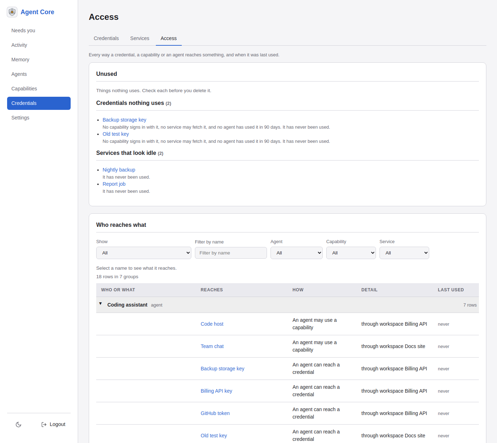
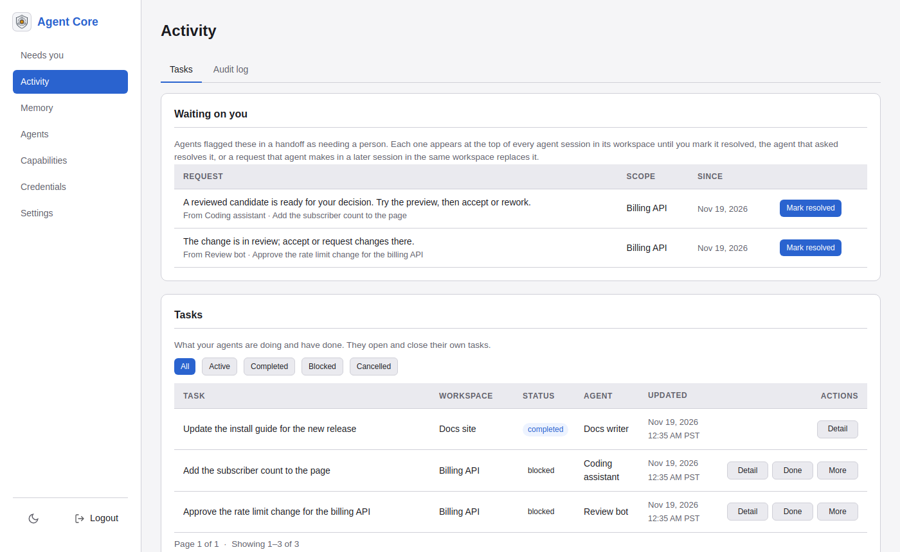
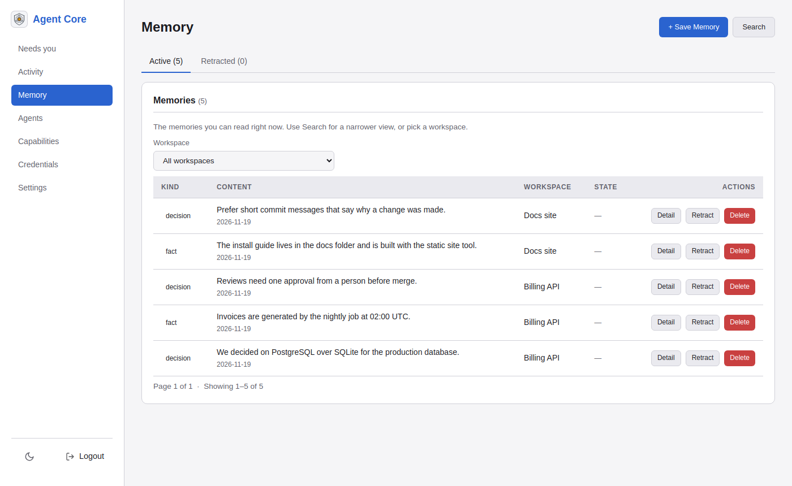

# Dashboard map (1.4.0)

The dashboard is for setting things up and for the few things that need a person. Nothing here is a chore that comes back every week.

Seven sidebar entries in one plain list; every other page is a tab inside one of them, and every old address still works.

| Entry | Tabs | What it is for |
| --- | --- | --- |
| **Needs you** (`/`) | Approvals | The one list of what is waiting on a person: approvals (open to review), questions an agent left in a handoff, and credential requests, which are answered right in their row. An empty list says there is nothing to do. Below it: a Health strip (capabilities, webhooks, local credential helper, network limits), search, and recent activity. A **Getting started** card shows until an agent has worked, with optional two-step sign-in as its last item. |
| **Activity** (`/activity`) | Audit log (admin) | What agents are doing and have done. A task row opens to its result, latest note, next steps, open questions and any ask to a person. Agents open and close their own tasks; a task nobody updates for 48 hours closes itself as "ended without report". The audit log is its own tab. |
| **Memory** (`/memory`) | none | Search, browse and save memories; retract (hidden from search, restorable for the retention period) and restore. The Retracted view is the same table as Active, with Restore where Retract was and who or which rule retracted each one. Nothing asks you to review memories: plain noise retracts itself. |
| **Agents** (`/agents`) | Workspaces, Connect | It lists the agents that do work; the programs and containers that only fetch secrets are under **Credentials > Services** (`/services`), and the old address `/agents?show=services` redirects there. Create an agent and choose what it can read and write; each row has an **Access** button that opens one dialog about that agent: the workspaces it may read and write, the capabilities it can use, the credentials it can reference, its keys and its permissions, and what an added or removed workspace would open or close, shown before anything is saved; the same dialog can **add a capability** the agent does not have yet, and shows who gains it before it is saved; a permission the agent lacks is shown as needing it, with a **Turn on** button, and nothing is switched on by itself; **Workspaces** lists the workspaces, their collaborators and their repository folders; **Connect** generates the agent's key (shown once), tool configuration, instructions and a four-step verification prompt, and its access check has a **Give access** button. |
| **Capabilities** (`/connectors`) | none | The capabilities an agent may use (GitHub, a plain web capability, an MCP server) and the connections to them. A new connection is tested as soon as it is created. A credential entered while adding a connection belongs to that connection: no agent can reach it, only Agent Core uses it (tick **Also let agents reference this credential** to store it under the connection's owner instead). Deleting a connection asks whether its credential goes with it, and keeps it when a service still receives it. Each connection has a **Who can use it** button that lists and edits who may use it: named agents, everyone in a workspace, or all of one person's agents, with an exclusion for a single agent, and every change shows who gains it and who loses it before it is saved. |
| **Credentials** (`/credentials`) | Services, Access | The stored credentials, each with one **Who can use this** list in three groups: the capabilities that sign in with it, the agents that can reach it, and the services that receive its value. A credential that belongs to a connection is listed with that connection's name, and no agent can reach it. **Services** lists the programs and containers that only fetch secrets; each row has an **Access** button that lists the secrets that service may fetch (read or write, end date) and lets you add or remove them. **Access** is the whole list in one place: every assignment (a capability signing in with a credential, an agent using a capability, an agent reaching a credential, a service fetching a credential) with when each was last used and any action that waits for a person, filters by agent, capability or service, rows grouped under one closed header per "Who or what" that opens on click or when a filter matches, and an **Unused** list of the credentials nothing uses, the capabilities nobody can use, the services that look idle and what a retired agent or service left behind. |
| **Settings** (`/settings`) | Users, Webhooks (admin) | Account and two-step sign-in, memory and search settings, data and backup, security and network limits. Run Maintenance, Re-embed and Prune Log sit behind an Advanced fold: maintenance runs by itself every hour. |

## What the pages look like

The screenshots use invented names and data.

**Needs you** is the home page: what is waiting on a person, then the health strip.

**Agents** lists the agents that do work. **Access** on a row opens the dialog that shows what that agent can do and reach.

**Capabilities** holds the ready-made capabilities and the connections you set up with them. **Who can use it** on a connection opens its list of users.

**Credentials** holds the stored secrets. **Access** on a credential opens **Who can use this**.

**Credentials > Access** shows every way something reaches something, with the **Unused** card above it.

**Activity** lists what agents are doing and have done. **Memory** lists what they have saved.

## Not in the dashboard

There is no review queue, no stale-task list, no pinned standing context, no "assign a task to an agent" and no confidence column. See the 1.3.0 entries in the changelog.

## For a phone

The navigation is behind a **Menu** button; rows become blocks with the labels beside the values.
